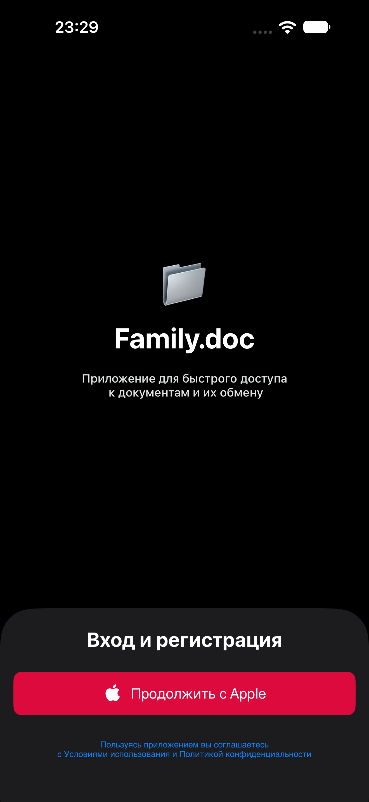
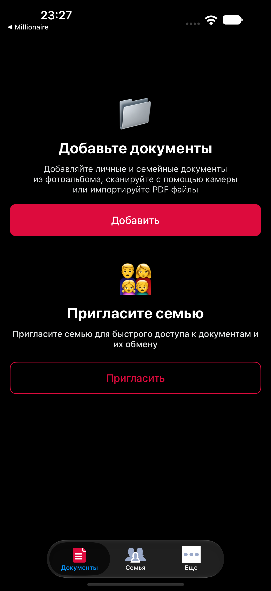

# DocFam / Домашние документы 

> **Проект больше не поддерживается.**
> Оставлен как учебный для ознакомления и истории. 
> Код может быть неполным, устаревшим или содержать учебные упрощения.

Приложение для хранения и систематизации домашних документов семьи. Все важные бумаги — паспорта, свидетельства, полисы, договоры, квитанции — в одном месте, с удобной структурой и быстрым поиском. Приложение создано для того, чтобы каждая семья могла держать свои документы в порядке. Вместо разрозненных папок и бумажных архивов — единое цифровое хранилище с понятной иерархией: **семья → член семьи → категория документа → сам документ**.

<picture>
  <source media="(prefers-color-scheme: dark)" srcset="Screens/Screenshot_1_Dark.png">
  <source media="(prefers-color-scheme: light)" srcset="Screens/Screenshot_1_Light.png">
  
</picture>
&nbsp;&nbsp;&nbsp;
<picture>
  <source media="(prefers-color-scheme: dark)" srcset="Screens/Screenshot_2_Dark.png">
  <source media="(prefers-color-scheme: light)" srcset="Screens/Screenshot_2_Light.png">
  
</picture>

## Возможности
- 📁 **Иерархия документов** — семья, члены семьи, категории, файлы
- 🔍 **Быстрый поиск** — по имени, категории или дате
- 🔐 **Вход через Apple Sign-In** — безопасно, без паролей и регистрации
- ☁️ **Синхронизация** между устройствами пользователя
- 🖼️ **Просмотр сканов** и фотографий документов
- 📌 **Избранное** — самые нужные документы под рукой
- 🏷️ **Категории** — паспорта, полисы, свидетельства, договоры, квитанции
- 🗂️ **Сортировка** — по дате, имени, категории

## Технологии
| Технология | Назначение |
|------------|-----------|
| **Apple Sign-In** | Аутентификация пользователя без пароля |
| **Swinject** | Dependency Injection (DI) |
| **MVVM** | Архитектурный паттерн: Model — View — ViewModel |

### Почему Apple Sign-In
- 🔒 **Безопасность** — Apple не передаёт личные данные приложению
- ⚡ **Скорость** — вход в один тап, без ввода пароля
- 🙈 **Приватность** — можно скрыть настоящий email (функция Hide My Email)
- 🔗 **Кроссплатформенность** — работает на iPhone, iPad, Mac
- ✅ **Доверие** — пользователи чаще выбирают приложения с Apple Sign-In

## Преимущества
- 🚧 Все документы семьи в одном месте
- 🚧 Не нужно помнить, где лежит бумага
- 🚧 Работает без интернета — данные хранятся локально
- 🚧 Синхронизация через iCloud
- 🚧 Безопасный вход по Apple ID
- 🚧 Понятный интерфейс для любого возраста
- 🚧 Единый стиль для iPhone и Mac
